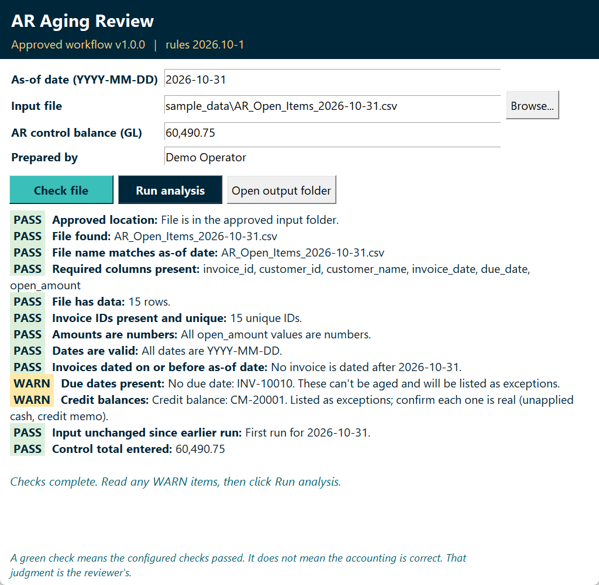

# AR Operator Handoff Demo

*A small, tested accounts receivable aging review with two operator front doors: a guided terminal launcher and a desktop window. Same calculation script behind both.*

> **Part of a PythonMuse Lab.** [I Built the Workflow. Now How Does My Team Use It?](https://pythonmuse.com/46-team-ready-workflows/) is the *Understand* layer. [The technical appendix](https://pythonmuse.com/46-team-ready-workflows/technical-appendix/) is *Implement*. This repository is *Experiment*.

You built a workflow with an AI co-pilot. It works. Now someone who has never opened your code editor needs to run it at month-end, and a reviewer needs to trust what comes out. This demo shows one way to do that: the accounting rules live in a rules file, the calculation lives in tested Python, and the operator gets a front door that checks the input, refuses to run on a bad file, and produces an Excel workpaper with the evidence a reviewer needs.

No AI model runs at any point. An AI co-pilot helped design, build, and test this code; the code runs on its own.



---

## What you'll see

Run against the October 2026 sample file with an AR control balance of 60,490.75, the review produces:

- **15 open items** for **7 customers**, totaling **60,490.75**, which **reconciles** to the control balance with a difference of 0.00.
- **Aging:** Current 27,750.00 · 1-30 days 14,000.00 · 31-60 days 7,350.50 · 61-90 days 6,575.25 · Over 90 days 4,175.00 · No due date 640.00.
- **6 exceptions to review:** two invoices more than 90 days past due, one invoice with no due date, one credit balance, one zero-balance line, and one customer whose total (28,300.00) is above the 25,000.00 review threshold.
- **A workpaper** with seven sheets: Summary, Exceptions (with blank Disposition and Reviewer notes columns), Reconciliation, Validation, Detail, By Customer, and Run Info (as-of date, the input file's SHA-256 fingerprint, rules version and fingerprint, code version, and blank sign-off fields).

A committed copy of that workpaper is in [examples/expected_output/](examples/expected_output/), so you can see the result before you run anything.

---

## Run it

You need Python 3.10 or later. Tkinter, the toolkit the desktop window uses, comes with the standard python.org installers for Windows and macOS. On Linux it is often a separate package (on Debian and Ubuntu, `python3-tk`). Running `python -m tkinter` opens a small test window if it is installed.

Download or clone the repository, then run from inside it:

```bash
python -m venv .venv
# Windows:  .venv\Scripts\activate
# macOS/Linux:  source .venv/bin/activate
pip install -r requirements-dev.txt

python -m pytest              # the automated tests
python run_desktop.py         # the desktop window
python run_terminal.py        # the guided terminal launcher (it asks questions)
```

In either front door, use as-of date `2026-10-31`, the file `sample_data/AR_Open_Items_2026-10-31.csv`, and control balance `60490.75`.

The terminal launcher also takes every answer as an option, which is handy for a quick check:

```bash
python run_terminal.py --as-of 2026-10-31 --input sample_data/AR_Open_Items_2026-10-31.csv --control-total 60490.75 --prepared-by "Demo Operator" --yes
```

Expected ending:

```text
Run 2026-10-31-run01: CHECKS PASSED - READY FOR REVIEW
  Aging total           60,490.75
  Control balance       60,490.75
  Difference                 0.00
  Lines 15, customers 7, exceptions to review 6
  Workpaper: ...output/2026-10-31/AR_Aging_Workpaper_2026-10-31-run01.xlsx

A green check means the configured checks passed. It does not mean the accounting is correct. That judgment is the reviewer's.
```

Now try a broken file, the kind you get when an ERP upgrade renames two columns:

```bash
python run_terminal.py --as-of 2026-10-31 --input sample_data/bad_schema/AR_Open_Items_2026-10-31.csv --control-total 60490.75 --prepared-by "Demo Operator" --yes
```

```text
[STOP] Required columns present
       Missing: due_date, open_amount. Unexpected columns: DueDate, Balance. The export format may have changed. Stop and escalate to the maintainer.
----------------------------------------------------------------------
STOP: fix the items marked [STOP], or escalate. Nothing was run.
```

Nothing is written when a run is blocked. Each run's workpaper goes to `output/<as-of date>/`, and every completed run is added to `output/run_log.csv`. The `output/` folder is not committed.

Exit codes, for anyone scheduling the terminal launcher: 0 ready for review, 2 blocked, 3 reconciliation difference, 4 no control total, 5 cancelled by the operator, 1 could not start.

---

## The seeded exceptions (deliberate: please don't "fix" them)

Every problem in the sample data is there on purpose, so the checks have something to catch. The tests depend on them.

| Where | What is wrong with it | What should happen |
|---|---|---|
| `AR_Open_Items_2026-10-31.csv`, INV-10008 | 91 days past due | Listed as an exception |
| same file, INV-10007 | Exactly 90 days past due | **Not** listed (the rule says *more than* 90). A good item to spot-check |
| same file, INV-10009 | 120 days past due | Listed as an exception |
| same file, INV-10010 | No due date | Amber warning; listed; not aged |
| same file, CM-20001 | Credit balance of -1,200.00 | Amber warning; listed |
| same file, INV-10015 | Zero balance on an open-items report | Listed |
| same file, customer C006 | Total 28,300.00, above the 25,000.00 review threshold | Listed |
| `bad_duplicate_id/` | INV-10004 appears twice | Stop: totals can't be trusted |
| `bad_schema/` | `due_date` and `open_amount` renamed | Stop and escalate: the export changed |
| `wrong_date/` | September's file picked for an October review | Stop: file name doesn't match the as-of date |
| `tampered/` | INV-10009 edited from 2,300.00 to 230.00 | After an October run exists: stop, because the file differs from the one already used. On its own: the run doesn't reconcile (2,070.00 short) |

The expected figures in [tests/test_known_answers.py](tests/test_known_answers.py) were calculated by hand, line by line, before the tests were written. The working is in that file's opening comment.

---

## What the operator checks afterward

The [Operator Guide](OPERATOR_GUIDE.md) is the one-page procedure. In short:

1. The aging total reconciles to the AR control balance from the general ledger.
2. The customer count and line count look right for the month.
3. Every exception has a disposition: credits, missing due dates, items over 90 days, customers over the threshold.
4. A few *unflagged* lines, picked from different buckets, are checked against the source. INV-10007, one day short of the 90-day flag, is a good one to try.

---

## Limits and controls (plain English)

This is a teaching demo, not a production system. It shows the shape of a controlled handoff; it does not supply the controls your organization would need around it.

- **A friendly interface is not a control.** The front doors make the right path easy. They are not a security boundary: anyone who can open the folder can open the files.
- **A green check is not a sign-off.** The checks confirm the file is the right shape and the total ties. They can't tell you the export was complete, that a credit is real, or that a 120-day invoice is collectible.
- **What production would add:** access control on the input, output, and rules folders; an approved place to host and install it; change management for the code and the rules (who approves, how versions are released); a named owner; backup of the run log and workpapers; and, if you package it as an executable, your IT team's process for signing and distributing software.
- **No network calls and no AI model calls** happen at runtime. Accounting data stays on the machine that runs it.
- **The approved input folder** in the rules file is checked by the code, but real protection comes from folder permissions set by IT.

---

## For the maintainer

- **Owner:** the role that owns the code, the tests, and the rules file. In this demo, that's whoever forks it.
- **Setup:** the commands above. Dependencies are pinned in `requirements.txt` (runtime) and `requirements-dev.txt` (adds pytest).
- **Changing rules:** buckets, thresholds, tolerance, the file name pattern, and the approved input folder live in [config/rules.example.yaml](config/rules.example.yaml). A change needs the rules owner's approval and a new `rules_version`. The version and the file's SHA-256 fingerprint print on every workpaper, so old results stay explainable. Run the tests after any change; the known-answer tests will tell you if a "small" threshold change moved a total.
- **Updates and rollback:** release a new version by tagging a commit and bumping `__version__` in `src/ar_handoff/__init__.py`. Roll back by reinstalling the previous tag. Workpapers record the code version, so you can tell which runs used which release.
- **Incident:** if a run used a wrong file or wrong rules, don't edit the workpaper. Mark it superseded in your review record, fix the cause, and re-run. To re-run a period that already has a run with a *corrected* export, the terminal launcher's `--corrected-export "reason"` option records the reason on the workpaper and in the run log. The desktop window deliberately doesn't offer it; operators escalate, maintainers act.

---

## How it's built

```text
config/rules.example.yaml    approved rules and thresholds (illustrative values)
sample_data/                 synthetic files, with deliberately seeded problems
src/ar_handoff/
    validate.py              the input contract: what blocks and what warns
    engine.py                the calculation script: aging, exceptions, reconciliation; no interface code
    workpaper.py             the Excel workpaper and run metadata
    runlog.py                the append-only run log
    runner.py                check, then run; the only module the front doors call
    launcher.py              guided terminal front door (thin)
    desktop.py               Tkinter front door (thin)
tests/                       known answers, invalid inputs, boundaries, repeat runs, launchers
examples/expected_output/    a committed sample workpaper and run log
```

The two front doors only call `runner.check()` and `runner.run()`, and a test enforces that neither imports the calculation or validation modules, so they can't disagree about the accounting.

---

## Synthetic data

All customer names, invoice numbers, and amounts are fictional and were made up for this demo. Any resemblance to a real business is a coincidence.

## License

Code is MIT-licensed (see [LICENSE](LICENSE)). Prose quoted from the PythonMuse article remains CC BY-NC-SA 4.0. This is educational material, not accounting, audit, or legal advice.

*PythonMuse LLC | [www.pythonmuse.com](https://www.pythonmuse.com)*
